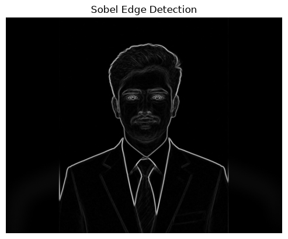
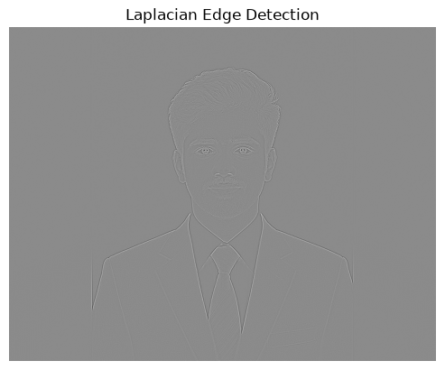
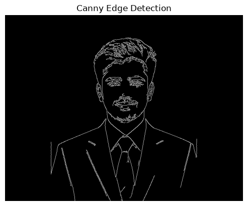

# Experiment 6 – Edge Detection

## Name
MUTHUAKASH M

## Register Number
212225230194

## Aim
To detect the edges in an image using different edge detection techniques such as Sobel Edge Detection, Laplacian Edge Detection, and Canny Edge Detection using OpenCV and Python.

## Software Required
- Python
- Jupyter Notebook
- OpenCV (`cv2`)
- NumPy
- Matplotlib

## Input Image Required
- `Qno. 1.jpg`

Place the input image in the same folder as the Jupyter Notebook or Python program.

## Algorithm

1. Import the required libraries: OpenCV, NumPy, and Matplotlib.
2. Read the input image using `cv2.imread()`.
3. Convert the original image from BGR to grayscale using `cv2.cvtColor()`.
4. Display the original image by converting it from BGR to RGB.
5. Apply Sobel edge detection in the X direction using `cv2.Sobel()`.
6. Apply Sobel edge detection in the Y direction using `cv2.Sobel()`.
7. Combine the Sobel X and Y results using `cv2.magnitude()`.
8. Apply Laplacian edge detection using `cv2.Laplacian()`.
9. Apply Canny edge detection using `cv2.Canny()` with threshold values 50 and 150.
10. Display the detected edges.

## Program 1: Read and Display the Original Image

```python
import cv2
import numpy as np
import matplotlib.pyplot as plt

image = cv2.imread('Qno. 1.jpg')  # Replace with your image path
gray_image = cv2.cvtColor(image, cv2.COLOR_BGR2GRAY)

# Original Image
plt.imshow(cv2.cvtColor(image, cv2.COLOR_BGR2RGB))
plt.title('Original Image')
plt.axis('off')
```


## Program 2: Sobel Edge Detection

```python
sobel_x = cv2.Sobel(gray_image, cv2.CV_64F, 1, 0, ksize=5)  # Sobel in x direction
sobel_y = cv2.Sobel(gray_image, cv2.CV_64F, 0, 1, ksize=5)  # Sobel in y direction
sobel_combined = cv2.magnitude(sobel_x, sobel_y)  # Combine both directions

plt.imshow(sobel_combined, cmap='gray')
plt.title('Sobel Edge Detection')
plt.axis('off')
```


## Program 3: Laplacian Edge Detection

```python
laplacian = cv2.Laplacian(gray_image, cv2.CV_64F)

plt.imshow(laplacian, cmap='gray')
plt.title('Laplacian Edge Detection')
plt.axis('off')
```


## Program 4: Canny Edge Detection

```python
canny_edges = cv2.Canny(gray_image, 50, 150)

plt.imshow(canny_edges, cmap='gray')
plt.title('Canny Edge Detection')
plt.axis('off')
```


## Result

Thus, edge detection was performed successfully using Sobel, Laplacian, and Canny edge detection techniques in OpenCV and Python. The detected edges were displayed for observation and comparison.
